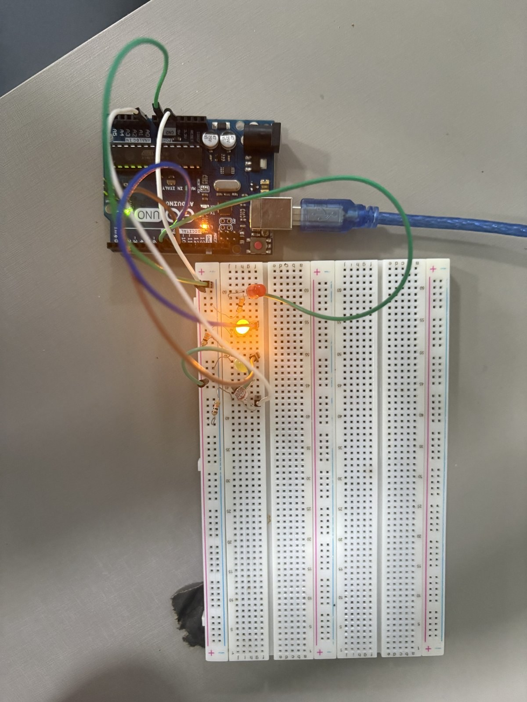

# Semáforo com dois modos de operação

**Atividade Ponderada de Computação 2, Módulo 4, Semana 4 (Inteli)**
**Autor:** Mateus Tognola · **RA:** A2026.1A.0217
**Professoras:** Andréa Zotovici e Marcela Amorim da Costa

**Vídeo da demonstração:** _[colar aqui o link do vídeo]_

---

## 1. Contexto

Este projeto implementa, em um protótipo físico com Arduino Uno, o semáforo de uma via do bairro Butantã sob responsabilidade do Departamento de Engenharia de Trânsito. O semáforo opera em dois modos. No modo normal, ele percorre o ciclo vermelho, verde e amarelo com os tempos definidos pelo plano semafórico do meu RA. No modo noturno, apenas a luz amarela pisca, indicando ao motorista que ele deve atravessar com cuidado, o que evita que alguém fique parado em um cruzamento deserto durante a madrugada. A troca entre os modos é automática e depende da luminosidade medida por um sensor LDR.

O ponto central da atividade não é apenas fazer o modo noturno funcionar, mas decidir em que momento o semáforo deve entrar nele e sair dele, sem que o sistema fique alternando entre os dois modos quando a luz ambiente estiver próxima do limite. Essa decisão foi resolvida com histerese, como descrito na seção 4.

## 2. Plano semafórico

O plano é calculado a partir do último dígito do RA. O tempo de vermelho é de 5 segundos mais esse dígito, o tempo de verde é de 3 segundos mais a metade do dígito arredondada para baixo, e o amarelo dura 2 segundos para todos.

| Último dígito do RA | Vermelho | Verde | Amarelo |
|:---:|:---:|:---:|:---:|
| 7 | 12 s | 6 s | 2 s |

No código, basta alterar a constante `ULTIMO_DIGITO_RA` para que os três tempos sejam calculados automaticamente. O arredondamento para baixo acontece de forma natural porque, em C++, a divisão entre dois inteiros descarta a parte decimal (por exemplo, `7 / 2` resulta em `3`). Os tempos calculados são impressos no Monitor Serial assim que a placa liga, o que permite conferir o plano antes de cada teste.

## 3. Circuito

O circuito segue a lógica do divisor de tensão apresentado na Aula 5, adaptado para o Arduino Uno, que foi a placa disponível no kit. O LDR forma um divisor de tensão com um resistor de 10 kΩ: uma perna do LDR vai ao 5 V, a outra vai ao pino analógico A0, e o resistor fecha o caminho do A0 até o GND. Como a resistência do LDR diminui quando ele recebe mais luz, a tensão no ponto do meio sobe, e o conversor analógico-digital do Uno, de 10 bits, entrega um número maior, na escala de 0 a 1023. Assim, mais luz corresponde a uma leitura maior.

Cada LED é ligado em série com um resistor de 220 Ω, que limita a corrente. Na montagem, o resistor ficou entre o terminal negativo do LED e o GND, o que simplifica a disposição na protoboard; como os dois componentes estão em série, a corrente é a mesma que se o resistor estivesse antes do LED. Foram usados os pinos digitais 8, 9 e 10, evitando os pinos 0 e 1, que o Uno usa na comunicação serial com o computador, e o pino 13, que pisca durante a inicialização da placa.

| Componente | Pino do Arduino Uno | Ligação |
|---|---|---|
| LDR | A0 | 5V → LDR → A0 → 10 kΩ → GND |
| LED vermelho | 8 | pino 8 → LED → 220 Ω → GND |
| LED amarelo | 9 | pino 9 → LED → 220 Ω → GND |
| LED verde | 10 | pino 10 → LED → 220 Ω → GND |

O mesmo código também compila para o ESP32. Nesse caso, os pinos passam a ser o GPIO 34 para o LDR (alimentado em 3,3 V) e os GPIO 16, 17 e 18 para os LEDs, e os limiares mudam para a escala de 0 a 4095 do conversor de 12 bits. A escolha é feita automaticamente pela diretiva `#if defined(ARDUINO_ARCH_ESP32)`, de acordo com a placa selecionada na IDE.


Figura 1 – Protótipo do semáforo montado na protoboard. Fonte: elaborado pelo autor (2026).

## 4. Decisão de entrada e saída do modo noturno

### 4.1 O problema de um único limiar

A solução mais simples seria escolher um único valor de leitura, por exemplo 250, e ligar o modo noturno sempre que a leitura ficasse abaixo dele. O problema é que a leitura de um LDR nunca é perfeitamente estável. Pequenas variações de luz, o próprio ruído elétrico do sensor e a quantização do conversor fazem o valor oscilar algumas dezenas ou centenas de unidades para cima e para baixo. Quando a luz ambiente está perto do limiar, como acontece ao entardecer, essas oscilações cruzam o limite várias vezes por segundo, e o semáforo passaria a alternar continuamente entre o ciclo normal e o amarelo piscante. Para um motorista, um semáforo que muda de comportamento a todo instante é confuso e perigoso.

### 4.2 A solução com histerese

A histerese resolve esse problema substituindo o único limiar por dois limiares diferentes, um para entrar e outro para sair do modo noturno. Neste projeto, o semáforo só entra no modo noturno quando a média da leitura cai abaixo de 200, e só volta ao modo normal quando a média sobe acima de 330. Entre esses dois valores existe uma zona morta, na qual o semáforo simplesmente mantém o modo em que já está.

```
leitura do LDR (0 a 1023)
1023 ┤  mais luz
     │
 330 ┤──────── só VOLTA ao modo NORMAL se a média passar daqui para cima
     │   zona morta: o semáforo MANTÉM o modo atual
 200 ┤──────── só ENTRA no modo NOTURNO se a média cair daqui para baixo
     │
   0 ┤  menos luz
```

A estabilidade vem do fato de que a largura dessa faixa, de 130 unidades, é bem maior do que a amplitude do ruído do sensor. Depois que a leitura cai abaixo de 200 e o semáforo entra no modo noturno, o ruído pode até fazer o valor subir para 210 ou 220, mas nunca o bastante para alcançar 330. Por isso o modo troca uma única vez e permanece estável, e só volta a mudar quando a luz de fato aumenta de forma significativa.

Além da histerese, o programa calcula uma média móvel das dez últimas leituras, feitas a cada 50 ms, o que corresponde a uma janela de meio segundo. A média suaviza os picos isolados antes da comparação com os limiares, mas é importante destacar que ela é apenas um complemento: sozinha, ela reduziria a oscilação sem eliminá-la, porque a média também pode ficar indo e voltando em torno de um único limiar. Quem garante a estabilidade é a histerese.

### 4.3 Calibração dos limiares

Como ponto de partida, foram usados os valores 300 e 400, que correspondem, na escala de 10 bits do Uno, aos limiares de 1200 e 1600 do exemplo da Aula 5. A leitura real, porém, depende da iluminação da sala e do LDR utilizado. Para calibrar, abri o Monitor Serial a 9600 baud e anotei a média com o sensor exposto à luz da sala e com o sensor coberto pela mão. Em seguida, posicionei o centro da faixa aproximadamente no meio desses dois valores e defini a largura da faixa como algumas vezes maior que a variação observada com a luz parada, de modo que o ruído nunca consiga atravessá-la. No meu protótipo, a média ficou em torno de 50 com a iluminação do ambiente, à noite, e chegou a cerca de 480 com a lanterna do celular a aproximadamente 5 cm do sensor. Como a faixa útil ficou entre esses dois valores, os limiares finais foram ajustados para 200 (entrada no modo noturno) e 330 (retorno ao modo normal), o que mantém uma zona morta de 130 unidades, muito maior que a oscilação de poucas unidades observada na média com a luz parada. Na demonstração, a lanterna representa a luz do dia e o seu afastamento representa o anoitecer.

## 5. Implementação

O código está em [`semaforo_noturno/semaforo_noturno.ino`](semaforo_noturno/semaforo_noturno.ino) e foi escrito para a IDE Arduino, com a placa Arduino Uno. A primeira decisão de implementação foi não usar `delay()` no ciclo do semáforo. Com o plano do RA, o vermelho pode durar até 14 segundos, e um `delay()` desse tamanho deixaria o programa cego para o sensor durante todo esse tempo. Em vez disso, todas as temporizações usam `millis()`, como no exemplo de leitura do LDR da Aula 5, de forma que o `loop()` continua lendo o LDR a cada 50 ms enquanto as luzes seguem o seu ciclo, e o semáforo reage à mudança de luminosidade em qualquer fase.

O programa é organizado como uma máquina de estados com dois modos, normal e noturno, e três fases dentro do modo normal, vermelho, verde e amarelo. Os LEDs são representados por uma classe `Led`, retomando a ideia de orientação a objetos da Aula 3, na qual o `loop()` decide o que deve acontecer e o objeto sabe como acender ou apagar o seu pino. A função `atualizarModo()` concentra a decisão avaliada: ela só troca para o modo noturno se o semáforo estiver no modo normal e a média estiver abaixo do limiar de entrada, e só troca de volta se estiver no modo noturno e a média estiver acima do limiar de saída. Em qualquer outro caso, nada acontece.

Duas escolhas de segurança foram adotadas nas transições. Ao sair do modo noturno, o ciclo recomeça sempre pelo vermelho, para que o semáforo não abra o verde de forma repentina. Ao ligar a placa, o semáforo só começa no modo noturno se a média já estiver claramente abaixo do limiar de entrada; se estiver na zona morta, ele começa no modo normal.

Como o Uno não tem a função `Serial.printf`, as mensagens são montadas por uma pequena função `imprimir()`, que usa `vsnprintf` para formatar o texto. O Monitor Serial exibe, a cada 300 ms, a leitura instantânea, a média, a posição da média em relação à faixa de histerese, o modo atual e um contador de trocas de modo. Esse contador foi pensado para o vídeo, porque permite mostrar que, mesmo com a fonte de luz se movendo devagar em torno do limiar, o número de trocas aumenta uma única vez.

## 6. Testes

Antes do teste físico, a lógica foi verificada no computador por meio de uma simulação ([`teste/simulacao.cpp`](teste/simulacao.cpp)), que substitui as funções da placa por versões simuladas e executa o próprio arquivo `.ino`. O LDR foi simulado com um ruído proporcional a ±150 unidades na escala de 0 a 4095 (cerca de ±25 na escala usada no Uno), maior do que o observado no sensor real, para tornar o teste mais exigente.

| Cenário simulado (Arduino Uno, limiares 200 e 330) | Com histerese | Com um único limiar (233), sem média |
|---|:---:|:---:|
| Luz diminuindo devagar e depois oscilando perto do limiar durante 60 s | 1 troca | 25 trocas |
| Luz parada no meio da faixa (233 ± 30) durante 60 s | 0 trocas | 603 trocas |
| Escuro de verdade seguido de claro de verdade | 2 trocas | — |

A simulação também confirmou que as fases seguem a ordem vermelho, verde e amarelo com exatamente os tempos do plano, que no modo normal apenas uma luz fica acesa por vez e que, no modo noturno, somente o amarelo pisca, alternando a cada meio segundo. Para executar a simulação, basta rodar `g++ -std=c++17 teste/simulacao.cpp -o simulacao && ./simulacao` a partir da raiz do repositório; acrescentando `-DARDUINO_ARCH_ESP32`, a mesma simulação roda com os parâmetros do ESP32, e os resultados são equivalentes. Além disso, o código foi compilado para o ATmega328P do Uno sem avisos do compilador, ocupando cerca de 20% da memória de programa e 36% da RAM.

No protótipo físico, a transição foi provocada aproximando e afastando lentamente uma fonte de luz em torno do limiar, conforme registrado no vídeo. Na demonstração, a lanterna do celular representou a luz do dia. Ao afastá-la lentamente, o semáforo entrou no modo noturno uma única vez e permaneceu estável enquanto a lanterna era movida em torno do limiar: o contador de trocas no Monitor Serial passou de 0 para 1 e não mudou mais.

## 7. Conclusão

O protótipo cumpre o plano semafórico do RA e alterna automaticamente para o modo noturno de acordo com a luminosidade. A histerese, com limiares distintos para entrar e para sair do modo noturno, impede que o ruído do LDR provoque trocas repetidas, porque uma oscilação pequena nunca percorre toda a distância entre os dois limiares. A média móvel e o uso de `millis()` complementam essa decisão, deixando a leitura mais estável e mantendo o semáforo sempre atento ao sensor.

## Referências

AGODOI. **m04-semana04**: sensores e processamento de valores de entrada analógicos para digital. GitHub, 2026. Disponível em: https://github.com/agodoi/m04-semana04. Acesso em: 8 nov. 2026.

ARDUINO. **Arduino Uno Rev3**: documentação técnica. Disponível em: https://docs.arduino.cc/hardware/uno-rev3/. Acesso em: 8 nov. 2026.

ZOTOVICI, Andréa. **Sensores e processamento de valores de entrada analógicos para digital**: Semana 4, Aula 5. São Paulo: Inteli, 2026. Material de aula.

ZOTOVICI, Andréa. **Arquitetura de microcontroladores e ponteiros**: Semana 3, Aula 4. São Paulo: Inteli, 2026. Material de aula.

ZOTOVICI, Andréa. **Programação básica usada em microcontroladores**: Semana 2, Aula 3. São Paulo: Inteli, 2026. Material de aula.

---

_Declaração de uso de IA: este projeto contou com o uso de ferramenta de IA generativa (Claude) para apoio na revisão do código-fonte e na organização do texto. Todo o conteúdo foi revisado e testado pelo autor._
